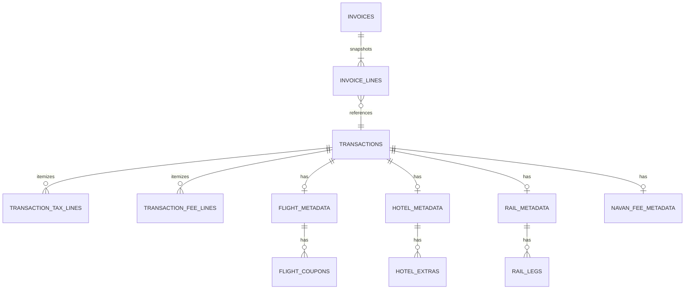

# System Architecture: Navan Travel Commerce & Invoice Service

This document details the architectural decisions, database models, concurrency controls, snapshot guarantees, and high-volume scaling characteristics of the service.

---

## 1. Data Model: Taxes, Fees, and Type-Specific Metadata

Rather than storing type-specific details in an untyped text/JSON blob, the domain is modeled as a normalized relational schema with strongly typed child tables and referential integrity:

- **Taxes vs Fees Separation:** Government/VAT charges live in `transaction_tax_lines` (`name`, optional `rate`, `amount`), while carrier/merchant charges live in `transaction_fee_lines` (`name`, `amount`). They are never merged into a single bucket.
- **Strongly Typed `TransactionType` Enum:** Transaction types are defined via a type-safe `TransactionType` enum (`FLIGHT`, `HOTEL`, `RAIL`, `NAVAN_FEE`, and `UNSUPPORTED`). Jackson's `@JsonCreator` parses incoming strings and maps unrecognized values to `UNSUPPORTED`, which is strictly rejected with `400 Bad Request`. A custom JPA `TransactionTypeConverter` stores the canonical lowercase string in SQLite, ensuring relational schema cleanlines and backward compatibility.
- **Flight:** `flight_metadata` (`origin`, `destination`, `fare`) joined to ordered `flight_coupons` (`flight_number`, `carrier`, `from_location`, `to_location`, `departure`, `arrival`, `coupon_order`).
- **Hotel:** `hotel_metadata` (`name`, `street`, `city`, `country`, `check_in`, `check_out`, `nights`, `room_rate_per_night`) joined to `hotel_extras` (`name`, `amount`).
- **Rail:** `rail_metadata` joined to ordered `rail_legs` (`origin`, `destination`, `departure`, `arrival`, `train_number`, `travel_class`, `leg_order`).
- **Navan Fee:** `navan_fee_metadata` (`fee_kind`: restricted to `trip_fee` and `agent_call_fee`, `description`, `related_external_id`).
- **Money Scale:** All monetary fields use `BigDecimal` with a fixed scale of 2 decimal places and `RoundingMode.HALF_UP`. Floating point IEEE 754 arithmetic is strictly prohibited.

---

## 2. Identity, Uniqueness & Concurrency

- **Database-Enforced Uniqueness:** The `transactions` table enforces a strict database `UNIQUE` constraint on `external_id`.
- **Sequential Duplicates:** A second `POST /transactions` with the same `external_id` queries the unique index, rejects the write, and returns **`409 Conflict`** with the existing record's `id`.
- **Concurrent Overlapping Creates:** When multiple clients post identical `external_id` payloads in parallel:
  - Application writes are synchronized for SQLite's single-writer architecture, while the database-level `UNIQUE` index provides the authoritative safety net.
  - Exactly one thread succeeds with `201 Created`.
  - Competing threads catch the constraint / existing entry and return `409 Conflict` with the created transaction `id`. Exactly one database row is persisted.

---

## 3. Immutable Invoice Snapshots & Freeze Protection

An invoice is a permanent commercial instrument. Once issued, changes to source bookings must never corrupt billed amounts.

1. **Snapshot Storage:** When `POST /invoices` is executed, the service captures a point-in-time snapshot of each transaction's totals, taxes, fees, and metadata into `invoice_lines`.
2. **Decoupled Persistence:** `GET /invoices/{id}` loads data strictly from `invoice_lines`. If a stored flight row in `transactions` is subsequently modified (e.g. total changed from 220.00 to 999.00), the invoice snapshot continues to reflect the frozen 220.00 EUR.
3. **Invoiced Transaction Protection (Freeze Rule):**
   - `PATCH /transactions/{id}` and `DELETE /transactions/{id}` perform an indexed check on `invoice_lines(transaction_id)`.
   - If the transaction is on **any** invoice, the operation aborts immediately with **`409 Conflict`**, ensuring billed money cannot be altered or torn.
4. **Invoice Deletion:** `DELETE /invoices/{id}` removes the invoice header and its snapshot lines, leaving the underlying transaction records intact.

---

## 4. High Volume & Scaling

### Database Indexing
- `transactions.external_id` (Unique index): O(1) duplicate identity lookups.
- `invoice_lines.transaction_id`: Enables instantaneous O(1) checks for "is this transaction on an invoice?" during `PATCH` and `DELETE` requests.
- `invoice_lines.invoice_id`: Fast snapshot joins when rendering `GET /invoices/{id}`.
- `transactions.occurred_at` & `invoices.created_at`: Range indexes for temporal queries and sorting.

### Strict Pagination Bounds
- `GET /transactions` and `GET /invoices` enforce bounded pagination: default `limit=50`, maximum `limit=100`.
- Requests specifying `limit > 100`, `limit < 1`, or negative offsets return **`400 Bad Request`**.
- Database queries use SQL `LIMIT` and `OFFSET` (via Spring Data `Pageable`). Unbounded table dumps (`SELECT *`) are completely blocked.

### What Breaks First Under Load & Mitigations
1. **SQLite Write Serialization (First Bottleneck):**
   - *Problem:* SQLite supports concurrent readers (WAL mode), but allows only one writer transaction at a time across the entire database file. Heavy concurrent write traffic will queue on the file write lock, eventually causing lock wait timeouts.
   - *Production Solution:* Migrate SQLite to a production client-server RDBMS (PostgreSQL / MySQL) supporting multi-version concurrency control (MVCC) and row-level locking (`SELECT ... FOR UPDATE` or `ON CONFLICT DO UPDATE`).
2. **Deep Offset Pagination:**
   - *Problem:* As table volume scales to millions of rows, `OFFSET 500000` forces the database engine to scan and discard 500,000 index entries.
   - *Production Solution:* Transition from offset pagination to keyset/cursor pagination (`WHERE id > :last_seen_id ORDER BY id ASC LIMIT :limit`).
3. **Snapshot Storage Growth:**
   - *Problem:* Storing full JSON snapshots per invoice line increases database size under high transaction volume.
   - *Production Solution:* Partition invoice snapshot tables by `created_at` year/month, or move finalized historical invoice snapshots to cold read-only object storage.
