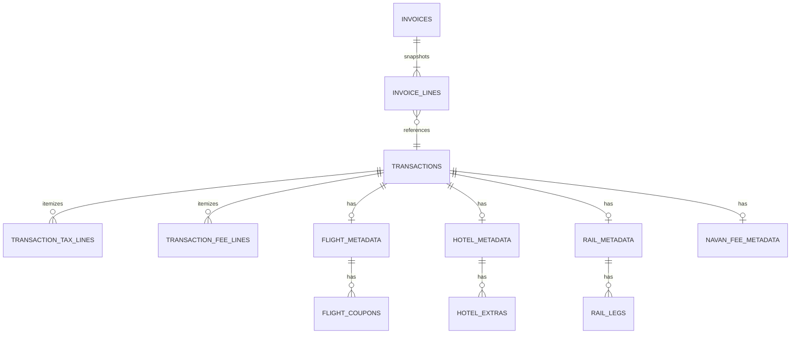
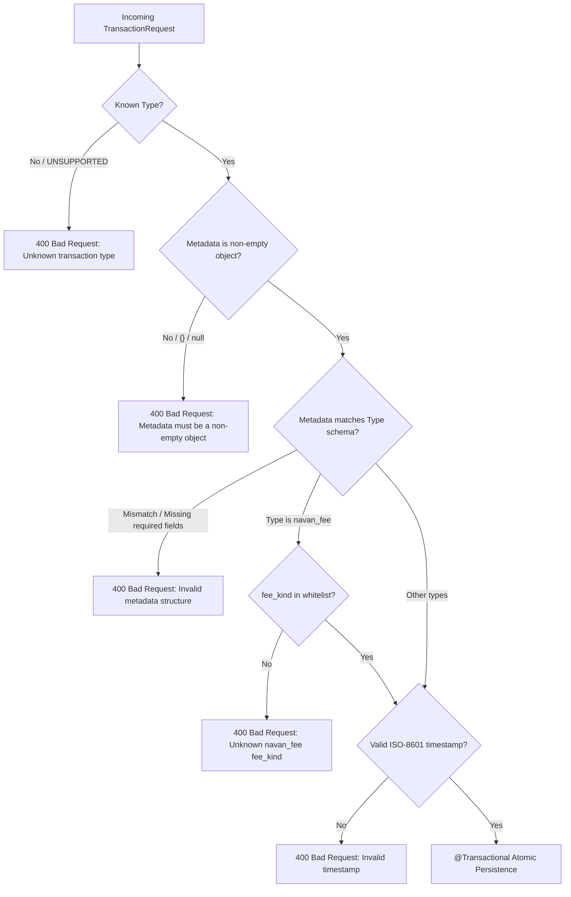
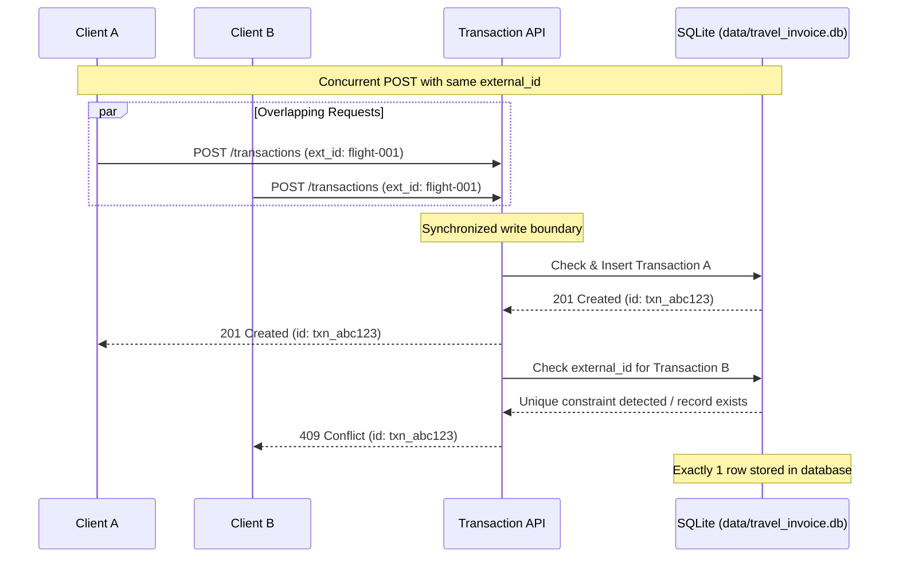
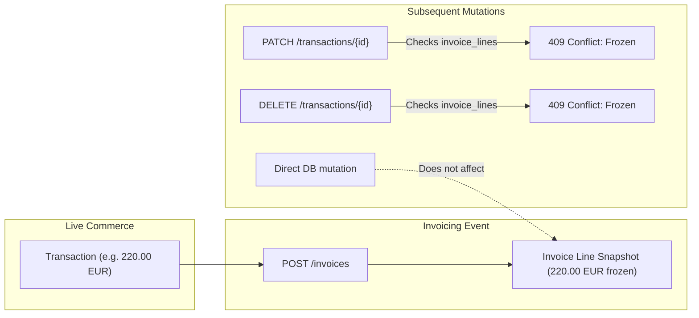

# System Architecture: Navan Travel Commerce & Invoice Service

This document details the architectural decisions, database models, concurrency controls, validation pipelines, snapshot guarantees, test coverage, and high-volume scaling characteristics of the service.

---

## 1. Data Model: Taxes, Fees, and Type-Specific Metadata

Rather than storing type-specific details in an untyped text/JSON blob, the domain is modeled as a normalized relational schema with strongly typed child tables and referential integrity:



### Table Breakdown
- **Taxes vs Fees Separation:** Government/VAT charges live in `transaction_tax_lines` (`name`, optional `rate`, `amount`), while carrier/merchant charges live in `transaction_fee_lines` (`name`, `amount`). They are never merged into a single bucket.
- **Strongly Typed `TransactionType` Enum:** Transaction types are defined via a type-safe `TransactionType` enum (`FLIGHT`, `HOTEL`, `RAIL`, `NAVAN_FEE`, and `UNSUPPORTED`).
  - Jackson's `@JsonCreator` parses incoming strings case-insensitively and maps unrecognized values to `UNSUPPORTED`, which is strictly rejected with `400 Bad Request`.
  - A custom JPA `TransactionTypeConverter` stores the canonical lowercase string in SQLite, ensuring relational schema cleanliness and backward compatibility.
- **Flight (`flight_metadata`):** Stores `origin`, `destination`, `fare NUMERIC(19, 2)` joined to ordered `flight_coupons` (`flight_number`, `carrier`, `from_location`, `to_location`, `departure`, `arrival`, `coupon_order`).
- **Hotel (`hotel_metadata`):** Stores `name`, `street`, `city`, `country`, `check_in`, `check_out`, `nights`, `room_rate_per_night NUMERIC(19, 2)` joined to `hotel_extras` (`name`, `amount NUMERIC(19, 2)`).
- **Rail (`rail_metadata`):** Joined to ordered `rail_legs` (`origin`, `destination`, `departure`, `arrival`, `train_number`, `travel_class`, `leg_order`).
- **Navan Fee (`navan_fee_metadata`):** Stores `fee_kind` (strictly validated to `trip_fee` or `agent_call_fee`), `description`, and `related_external_id`.
- **Relational Integrity & Foreign Keys:** Explicit foreign keys (`ON DELETE CASCADE` for transaction metadata and item collections, and `ON DELETE RESTRICT` for `invoice_lines.transaction_id -> transactions.id`) are enforced with `PRAGMA foreign_keys = ON;` and defined in `src/main/resources/schema.sql`.
- **Multiple Invoice Inclusion:** A transaction may appear on multiple invoices if commercial invoicing processes require separate billing items; however, once billed on any invoice, the underlying transaction row is permanently frozen against `PATCH` and `DELETE` modifications.
- **Money Scale:** All monetary fields use `BigDecimal` with a fixed scale of **2 decimal places** and **`RoundingMode.HALF_UP`**. Floating-point IEEE 754 arithmetic is strictly prohibited across all calculation paths.

---

## 2. Validation Pipeline & Metadata Integrity

Before any database entity is created or modified, requests pass through a strict validation pipeline in `TransactionService`:



### Key Validation Policies
1. **No Empty Dummy Metadata:** Requests with `"metadata": {}` or `null` fail immediately with `400 Bad Request`.
2. **No Cross-Type Storage:** Submitting a flight payload with hotel metadata (or rail with flight metadata) is caught by type-specific DTO deserialization and validation:
   - Flight requires `origin`, `destination`, `fare`, and a non-empty list of `coupons`.
   - Hotel requires `name`, `address` (with `street`, `city`, `country`), `check_in`, `check_out`, `nights`, and `room_rate_per_night`.
   - Rail requires a non-empty list of `legs` with valid departure/arrival details.
3. **Navan Fee Whitelist:** `fee_kind` must match either `trip_fee` or `agent_call_fee`. Any unrecognized value (e.g. `vip_lounge_fee`) returns `400 Bad Request`.
4. **Atomic Persistence:** Persistence of the transaction header, tax lines, fee lines, and metadata child tables occurs in a single Spring `@Transactional` block. If any validation or database operation fails, the transaction rolls back completely, ensuring no partial or corrupted records exist.

---

## 3. Identity, Uniqueness & Concurrency Controls



- **Database-Enforced Uniqueness:** The `transactions` table enforces a database-level `UNIQUE` index on `external_id`.
- **Sequential Duplicates:** Re-posting a known `external_id` queries the unique index, rejects the insert, and returns **`409 Conflict`** containing the existing record's server ID. Exactly one row is stored.
- **Concurrent Overlapping Creates:** When multiple clients post identical `external_id` payloads in parallel:
  - Application writes are synchronized at the service level, while the database-level `UNIQUE` index acts as the authoritative safety net.
  - Exactly one thread creates the record (`201 Created`).
  - Competing threads catch the constraint or existing record and return **`409 Conflict`** with the created transaction's ID.
  - Verified with 10 concurrent threads in `TravelCommerceIntegrationTest.test6_concurrentDuplicateCreate_leavesOneRow`.

---

## 4. Immutable Invoice Snapshots & Freeze Protection

An invoice is a permanent commercial instrument. Once issued, changes to source bookings must never corrupt billed amounts.



1. **Snapshot Storage:** When `POST /invoices` is executed, the service captures an immutable snapshot of each transaction's totals, taxes, fees, and metadata into `invoice_lines`.
2. **Decoupled Persistence:** `GET /invoices/{id}` loads data strictly from `invoice_lines`. If a stored flight row in `transactions` is subsequently modified in the database (e.g. total changed from 220.00 to 999.00), the invoice snapshot continues to reflect the frozen 220.00 EUR (verified by `test4_invoiceSnapshotImmutability`).
3. **Invoiced Transaction Protection (Freeze Rule):**
   - `PATCH /transactions/{id}` and `DELETE /transactions/{id}` perform an indexed check on `invoice_lines(transaction_id)`.
   - If the transaction is on **any** invoice, the operation aborts immediately with **`409 Conflict`**, ensuring billed money cannot be altered or torn.
4. **Invoice Deletion:** `DELETE /invoices/{id}` removes the invoice header and its snapshot lines, leaving the underlying transaction records intact (verified by `test9_deleteInvoice_preservesTransactions`).
5. **Invoice Snapshot Update:** `PATCH /invoices/{id}` accepts a new list of transaction IDs, validates currency consistency, recomputes rollups and totals, and updates the snapshot atomically.

---

## 5. Error Handling & HTTP Status Code Mapping

The global exception handling architecture in `GlobalExceptionHandler` ensures structured, consistent JSON error responses across the API:

| Exception Class | HTTP Status | Response Format | Scenarios Handled |
|---|---|---|---|
| `BadRequestException` | `400 Bad Request` | `{"error": "..."}` | Unknown transaction type, unknown `fee_kind`, empty `{}` metadata, cross-type metadata, invalid date, pagination bounds violated |
| `HttpMessageNotReadableException` | `400 Bad Request` | `{"error": "Malformed or missing request body"}` | Malformed JSON, unparseable bodies, missing body payload |
| `MethodArgumentNotValidException` | `400 Bad Request` | `{"error": "Validation failed: ..."}` | Bean validation constraint failures (`@NotBlank`, `@NotNull`) |
| `IllegalArgumentException` | `400 Bad Request` | `{"error": "..."}` | Invalid constructor arguments in repository/pagination classes |
| `NotFoundException` | `404 Not Found` | `{"error": "..."}` | Non-existent transaction ID, non-existent invoice ID |
| `ConflictException` | `409 Conflict` | `{"error": "...", "id": "..."}` | Duplicate `external_id`, duplicate transaction ID in invoice, mixed currency invoice, freeze rule violations |
| `DataIntegrityViolationException` | `409 Conflict` | `{"error": "Database conflict / unique constraint violation"}` | Database-level unique constraint collision during concurrent execution |
| `Exception` (catch-all) | `500 Internal Server Error` | `{"error": "Internal server error"}` | Unhandled system exceptions (stack trace securely logged to server) |

---

## 6. Testing, Quality Assurance & Coverage

### Automated Test Suite
The service is tested with **67 automated tests** across integration and unit test classes:
- **`TravelCommerceIntegrationTest` (30 tests):** Full HTTP lifecycle testing against a live random-port Spring Boot container and SQLite database. Covers happy paths and failure scenarios for all endpoints, metadata in-place patching, preserving fee lines during tax updates, rejecting type mutations, and bad input validation.
- **`GlobalExceptionHandlerUnitTest` (15 tests):** Unit tests covering all REST exception handlers, type mismatch, parameter validation, and OWASP-compliant sanitized responses.
- **`TransactionServiceValidationUnitTest` (10 tests):** Unit tests covering currency validation, scale validation, non-negative amounts, and lifecycle branches.
- **`EntityLifecycleTest` (4 tests):** Validates entity accessors and JPA lifecycle callbacks (`@PrePersist`, `@PreUpdate`).
- **`OffsetLimitRequestTest` (3 tests):** Validates limit/offset bounds, page calculation, sort preservation, and navigation (`next`, `previous`, `first`, `previousOrFirst`).
- **`TransactionTypeConverterTest` (2 tests):** Validates bidirectional JPA entity attribute and database column mapping, including null and unknown fallback handling.
- **`DatabaseConfigTest` (1 test):** Verifies database directory initialization and SQLite PRAGMAs.
- **`InvoiceServiceUnitTest` (1 test):** Verifies invoice creation and snapshot calculations.
- **`TravelCommerceApplicationTest` (1 test):** Validates Spring application context bootstrapping and main execution.

### JaCoCo Code Coverage
A strict JaCoCo coverage verification rule is enforced in `build.gradle` across all metrics (`minimum = 0.80`):

```bash
./gradlew test jacocoTestReport jacocoTestCoverageVerification
```

- **Instruction Coverage:** **97.0%**
- **Line Coverage:** **96.8%**
- **Branch Coverage:** **87.6%**
- **Complexity Coverage:** **90.6%**
- **Method Coverage:** **97.8%**
- **Class Coverage:** **100.00%**
- **Controllers Coverage:** **100.0%** (`TransactionController`, `InvoiceController`, `HealthController`)
- **Services Coverage:** **95.0% - 98.0%** (`TransactionService`, `InvoiceService`)

### Continuous Integration (GitHub Actions)
The service utilizes a GitHub Actions workflow defined in `.github/workflows/ci.yml`:
- **Automated Triggers:** Executed on `push` to `main`, `pull_request` to `main`, and manual `workflow_dispatch`.
- **Environment:** Ubuntu runner with Eclipse Temurin JDK 21 and official Gradle setup action with automated dependency and daemon caching.
- **Coverage Gate:** Any pull request or commit that causes line coverage to drop below 80% automatically fails `jacocoTestCoverageVerification`, blocking merge.
- **Step Summary & Artifacts:** A custom reporting step parses JUnit test results and `jacocoTestReport.xml` to publish an executive test summary (suite-by-suite breakdown of unit and integration tests) and the 6-metric JaCoCo coverage table to `$GITHUB_STEP_SUMMARY`, while full JaCoCo HTML/XML reports and JUnit test results are archived as workflow artifacts.

---

## 7. High Volume & Scaling

### Database Indexing Strategy
- `transactions.external_id` (Unique index): O(log n) B-Tree duplicate identity lookups.
- `invoice_lines.transaction_id`: Enables fast O(log n) B-Tree index checks for "is this transaction on an invoice?" during `PATCH` and `DELETE` requests.
- `invoice_lines.invoice_id`: Fast snapshot joins when rendering `GET /invoices/{id}`.
- `transactions.occurred_at` & `invoices.created_at`: Range indexes for temporal queries and sorting.

### Strict Pagination Bounds
- `GET /transactions` and `GET /invoices` enforce bounded pagination: default `limit=50`, maximum `limit=100`.
- Requests specifying `limit > 100`, `limit < 1`, or negative offsets return **`400 Bad Request`**.
- Database queries use SQL `LIMIT` and `OFFSET` (via Spring Data `Pageable`). Unbounded table dumps (`SELECT *`) are completely blocked.

### What Breaks First Under Load & Mitigations
1. **SQLite Write Serialization (First Bottleneck):**
   - *Problem:* SQLite supports concurrent readers (WAL mode), but allows only one writer transaction at a time across the entire database file. Heavy concurrent write traffic will queue on the file write lock, eventually causing lock wait timeouts.
   - *Production Solution:* Migrate SQLite to a production client-server RDBMS (PostgreSQL / MySQL) supporting multi-version concurrency control (MVCC) and row-level locking (`SELECT ... FOR UPDATE` or `ON CONFLICT DO UPDATE`).
2. **Deep Offset Pagination:**
   - *Problem:* As table volume scales to millions of rows, `OFFSET 500000` forces the database engine to scan and discard 500,000 index entries.
   - *Production Solution:* Transition from offset pagination to keyset/cursor pagination (`WHERE id > :last_seen_id ORDER BY id ASC LIMIT :limit`).
3. **Snapshot Storage Growth:**
   - *Problem:* Storing full JSON snapshots per invoice line increases database size under high transaction volume.
   - *Production Solution:* Partition invoice snapshot tables by `created_at` year/month, or move finalized historical invoice snapshots to cold read-only object storage.
